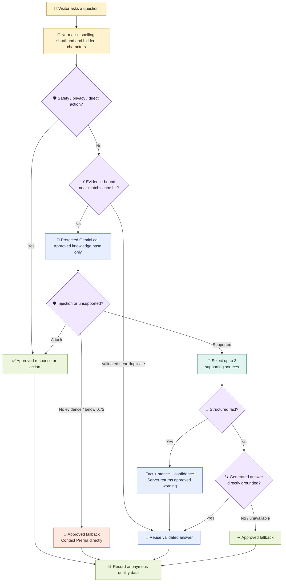
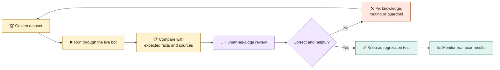

# Prerna Kapoor — Growth & Adoption Product Manager

Growth & Adoption Product Manager with 5+ years of experience building and scaling digital products across **activation, conversion, retention, customer experience, and revenue growth**.

I focus on the moments where high-intent users disengage: an abandoned booking, an unclear choice, an unread report, or a post-purchase issue. I use customer research, behavioural data, and fast experiments to turn those moments into durable product-growth loops.

## Selected Work

### Lenskart — Lenskart@Home
Owned growth initiatives across Lenskart@Home, an O2O eyewear experience spanning home trials, store ownership, and post-purchase journeys.

Selected outcomes:
- Initiatives contributed **₹6Cr+ in incremental annualised revenue**
- A personalised home-trial experience generated **₹1.8Cr annualised incremental revenue** across five cities
- A three-week, pan-India pilot improved completed home-trial bookings by **7%** versus the weekly baseline
- Territory ownership and 48-hour check-ins improved NPS for the called cohort from **41 to 60** in one month

### Bajaj Finserv Health
Built and scaled products across wellness, diagnostics, consultations, insurance, and digital health—from discovery and strategy through launch, GTM, and iteration.

Selected outcomes:
- Built a diabetes wellness business from 0→1, generating **₹28L revenue in five months**
- Smart Health Reports increased active Health Files users by **8×** and generated **₹7L+ incremental MRR**
- Doctor listing reorder improved CTR by **18%** and annual revenue by **11.6%**
- Automated insurance pre-authorisation, improving throughput by **26%** and saving **₹17L annually**

## How I Work
- Find the behavioural break in a customer journey
- Form a measurable hypothesis and test the smallest viable intervention
- Design adoption mechanics across product, operations, and lifecycle touchpoints
- Measure activation, conversion, retention, customer outcomes, and business impact
- Partner closely with design, engineering, operations, and commercial teams

## Portfolio
This repository includes detailed case studies, product experiments, and technical prototypes.

**Prerna Kapoor**  
Growth & Adoption Product Manager | Activation • Conversion • Retention • AI/Product

## Mira - portfolio chatbot

**Mira** helps visitors explore my experience, skills, projects, outcomes, and product philosophy without searching through the full portfolio.

- Recruiters get quick, evidence-based answers.
- The bot stays within information I have approved.
- Open-ended questions can use **Gemini Flash-Lite** to phrase concise, natural answers.
- Gemini runs behind a protected Vercel endpoint; its API key is never exposed in the browser.

Mira is a **guarded, evidence-grounded assistant**. Privacy, safety, confidential-data, and direct navigation requests use fixed approved responses. For every normal question, the protected backend gives Gemini the compact approved knowledge base; Gemini must select supporting sources before it may answer. Missing evidence produces the approved fallback.

## How one question becomes an answer

The diagram is designed to be read from top to bottom. Each colour represents a different decision path.

### Who answers what?

| Question type | Example | Answered by |
| --- | --- | --- |
| Direct action | “Where is her resume?” | ✅ Approved response + link |
| Work or recruiter question | “What impact did she drive at Lenskart?” | 🤖 Gemini evidence selection + grounded answer (or validated cache) |
| Open-ended portfolio question | “How does customer research shape her decisions?” | 🤖 Gemini selects approved evidence before answering |
| Private or confidential | “What is Lenskart's profit margin?” | 🛡️ Deterministic guardrail |
| Inappropriate or unsafe question | — | 🛡️ Respectful guardrail response |
| Unrelated question | “Who is the US president?” | 🛡️ Deterministic scope boundary |
| Missing evidence | An unpublished personal or work detail | 🤷 Safe fallback |

> **Important:** This pre-production version is no longer classic vector RAG. It uses **LLM-based evidence selection** over a compact approved knowledge base. Gemini chooses allowlisted sources, but it cannot add sources or facts, and unverified output is rejected.

## Tech stack—in plain English

- 🖥️ **Interface:** HTML, CSS, and JavaScript create the floating chat window.
- 📚 **Knowledge base:** portfolio passages, resume achievements, and verified interview-prep stories remain in `assets/chatbot-knowledge.js`. A pre-production pilot in `assets/mira-facts.js` adds governed facts with an approved claim, evidence references, answer, optional opposite/contrast answer, and approval status.
- ⚡ **Direct handling:** safety boundaries and actions such as resume access bypass retrieval and generation.
- 🛡️ **Guardrail routing:** private, unsafe, abusive, confidential, unrelated, and injection attempts receive controlled responses without reaching open-ended generation.
- ⚡ **Evidence-bound cache:** Golden Dataset cases pre-seed validated answers for exact or near-identical wording. A hit is allowed only while its approved sources still exist and the question stance matches; broader paraphrases go to Gemini.
- 🤖 **Evidence selection:** Vercel sends the compact approved knowledge base to Gemini. Gemini must return allowlisted source names, confidence, and—where relevant—fact ID and stance before an answer is accepted.
- ⚙️ **AI runtime:** Gemini runs behind a protected Vercel function. Visitors no longer download an embedding model or wait for WebGPU/model initialisation.
- ✅ **Validation:** checks block invented metrics, unsupported names, private claims, prompt leakage, and ungrounded sentences.
- ⚡ **Latency controls:** direct safety/actions and valid cache hits avoid Gemini; other questions use one backend model call with a 14-second browser ceiling before an approved fallback is shown.
- 🧪 **Local preview:** opening `index.html` directly cannot run the hosted Gemini endpoint, so open-ended questions fail closed. Deployed pre-production uses the complete evidence-selection flow.
- 🧪 **Golden evaluation dataset:** a growing set of fixed test cases defines the expected facts, sources, response type, and safety behaviour.
- 📊 **Analytics:** PostHog records anonymous quality, latency, fallback, feedback, and conversion events.
- 🚀 **Hosting:** GitHub + Vercel. The Gemini key is stored as a server-side Vercel environment variable.

## Terminology used in this project

| Term | What it means here |
| --- | --- |
| **Knowledge base** | The approved facts and portfolio passages the bot is allowed to use. |
| **Guardrail route** | Deterministic rules and approved responses for privacy, confidentiality, abuse, irrelevant questions, and prompt injection. It does not use RAG. |
| **Classic vector RAG** | An embedding model retrieves a shortlist before an LLM answers. Mira used this previously; the current pre-production pilot removes that browser retrieval step. |
| **Direct route** | Code that handles safety boundaries and clear actions such as resume access without asking Gemini. |
| **LLM-based evidence selection** | Gemini receives the compact approved knowledge base and must identify allowlisted supporting sources before answering. |
| **Evidence-bound near-match cache** | A conservative cache for validated exact or near-identical questions. It checks question stance and that every attached source remains approved. |
| **Evidence decision** | Gemini is instructed to select approved support and answer only when confidence is at least 0.72; no support produces a safe fallback. |
| **Structured fact** | An approved claim with evidence references, fixed answer wording, optional contrast wording, and test-only paraphrases. Test examples are not indexed for retrieval. |
| **Question stance** | Whether a question asks for the documented fact (`affirm`), asks whether its opposite is true (`negate`), or is too unclear to answer safely. |
| **Generator** | Gemini writes a concise answer using only the retrieved evidence. |
| **Grounding checks** | Output checks verify that Gemini's claims are supported by the retrieved sources. |
| **Fail-closed fallback** | If the system is uncertain or a component fails, it returns an approved safe answer. |
| **Golden evaluation dataset** | A fixed benchmark of questions with human-defined expected facts, sources, response types, and guardrail behaviour. |
| **Regression test** | A golden case that is rerun after changes to ensure a previously working behaviour has not broken. |
| **Human-as-judge** | A person reviews the actual answer for correctness, relevance, tone, and helpfulness. |
| **Telemetry** | Anonymous product data used to monitor latency, fallbacks, errors, helpfulness, and conversions. |

<strong>🛡️ Safety controls</strong>

- Detects direct and disguised prompt-injection attempts.
- Handles common spelling errors and selected Unicode or zero-width tricks.
- Limits questions to 500 characters and generated answers to 300 characters.
- Falls back safely when retrieval or the Gemini endpoint is unavailable, rate-limited, or slow.
- Keeps the Gemini API key on the server and accepts only allowlisted approved answers and sources.
- Applies a best-effort browser limit of 10 questions per minute.
- Keeps private, NSFW, confidential, and unsupported topics out of answers.

These controls reduce risk but are not foolproof. The client-side knowledge base should be treated as publicly visible.

## Golden evaluation dataset and eval console

The **golden evaluation dataset** lives in [`assets/eval-dataset.js`](assets/eval-dataset.js). Its cases test the **whole assistant system**: direct actions, guardrails, RAG retrieval, Gemini output, cache safety, fallbacks, safety, and response time. Because generated wording can vary, it defines required facts and behaviour rather than one exact sentence.

Each golden case contains:

- The test question and category
- The expected response type
- The expected route or behaviour when the case tests meaning-based retrieval
- The facts the answer must contain
- The source it should retrieve
- The guardrail behaviour expected for safety cases

The console labels these expectations as **Pass criteria — not model input**. They describe what a reviewer should look for; they are not secretly inserted into the visitor's question or sent to Gemini as the desired answer. Output-validation cases also show a **What this case is testing** explanation because those cases deliberately simulate an unsafe model response.

The [**eval console**](eval.html) runs these cases through the real chatbot and brings the expected and actual results together for review. It can filter results by answer source, including deterministic, RAG + LLM, fallback, guardrail, and error paths. Each result separates total request latency from the time spent in model generation, so slow retrieval or safety checks are not confused with a slow model.

For an open-ended case, **Compare models** runs the same question, retrieval, approved evidence, validation rules, and length limit through Gemini Flash-Lite and browser-hosted Qwen 2.5. The side-by-side output isolates generator quality from retrieval or routing quality and shows total latency, model-generation latency, answer source, and fallback status. If a deterministic or guardrail answer bypasses both models, the console says so instead of presenting identical answers as a meaningful model comparison. Qwen is evaluation-only; it is not used by the visitor-facing bot.

### What the golden dataset covers

- ✅ Profile facts, skills, experience, work and measurable outcomes
- ✍️ Paraphrases, misspellings and fuzzy matching
- 🧭 Vague wording, paraphrases and recruiter language that should retrieve the same evidence
- 🔒 Private, confidential, insulting and unrelated questions
- 🧨 Direct, disguised, multilingual and Unicode prompt injections
- 🚫 Invented metrics, fake employers, prompt leakage and unsupported claims
- 📴 Unavailable generation endpoint, timeouts and retrieval failures
- 🎯 False-positive checks so valid recruiter questions are not blocked

### What the reviewer can do

- Run all cases or rerun only those marked incorrect.
- Compare Gemini Flash-Lite and Qwen 2.5 side by side on an individual case.
- Compare the answer with expected facts, sources and guardrail behaviour.
- Mark it **Correct** or **Incorrect** and give a 1–5 helpfulness score.
- Speak feedback through voice dictation or type a reason.
- Export or import the review as JSON for the next iteration.

### How live feedback improves the bot

Every chatbot answer asks **“Was this helpful?”**

- 👍 **Helpful:** PostHog records a positive helpfulness signal.
- 👎 **Not helpful:** the visitor can select **Missing information**, **Incorrect information**, **Irrelevant answer**, **Too verbose**, or **Poor tone**.
- 🔗 The rating and reason are joined to the original question and answer through a request ID.
- 🔍 I review patterns to identify whether the problem is the knowledge base, retrieval, routing, generation, or tone.
- 🛠️ I update the relevant layer, rerun the golden dataset, and check that the fix does not break another answer.

This creates a continuous product loop:

`💬 Answer → 👍/👎 Feedback → 📊 PostHog analysis → 🛠️ Improvement → 🧪 Regression test → 🚀 Release`

## PostHog: measuring the portfolio as a product

PostHog is used for more than chatbot performance. It shows whether visitors discover relevant work, engage with the portfolio, and take a meaningful next step.

### Portfolio funnel

| Funnel stage | Product question | Signals monitored |
| --- | --- | --- |
| **Reach** | Are people finding the portfolio? | Page views, anonymous visitors, traffic source and campaign |
| **Explore** | Which work attracts interest? | Case-study opens and chatbot opens |
| **Engage** | Are visitors meaningfully interacting? | Questions asked, question themes, helpfulness and feedback reasons |
| **Consider** | Do visitors want more evidence? | Resume clicks and repeated case-study exploration |
| **Convert** | Do visitors want to speak with me? | Contact-section, email, phone and WhatsApp clicks |

### AI product health

| Quality | Performance and cost | Safety |
| --- | --- | --- |
| Correctness and helpfulness | P50/P95 latency | Injection decisions |
| Fallback and error rate | Cache hit/miss | Rate-limit events |
| Retrieved sources | Input/output tokens | Unsupported-output rejections |
| Feedback reasons | Estimated cost | Fail-closed responses |

The golden dataset is a **testing benchmark**, not the chatbot's knowledge base and not training data. This is **human-as-judge evaluation**, not automatic model training. Feedback is used to improve the answer bank, retrieval, guardrails, and regression suite; Gemini is not silently retrained.

See [TELEMETRY.md](TELEMETRY.md) and the [preproduction security audit](evaluations/PREPROD-SECURITY-AUDIT-2026-10-10.md).

## Product changelog

| Stage | What we had | Gap or insight | What changed and why |
| --- | --- | --- | --- |
| **1. First chatbot** | A separate portfolio section with retrieval-based answers | Visitors had to scroll to find it; many did not know what to ask | Replaced it with a visible floating bot and starter questions |
| **2. Curated answer bank** | Broad portfolio matching | Insults, private questions, confidentiality and unrelated queries could return irrelevant work answers | Added deterministic routing and approved guardrails for safe, graceful responses |
| **3. Better portfolio coverage** | Mostly project and company information | Recruiter questions about experience, skills, personality, location and hobbies were inconsistent | Expanded the approved knowledge base with verified professional and personal-profile facts |
| **4. Semantic retrieval** | Keyword and static-text matching | Misspellings and paraphrased questions were easy to misroute | Added fuzzy correction and MiniLM semantic retrieval to match meaning rather than exact words |
| **5. Open-source generation** | Retrieved, prewritten responses only | The experience demonstrated retrieval but not generative AI | Added browser-hosted Qwen 2.5 for concise synthesis from retrieved evidence, with ₹0 model API cost |
| **6. Evaluation system** | Manual spot checks | Improvements could fix one answer while breaking another | Built the golden dataset and eval console with human-as-judge review, incorrect-only reruns, voice feedback and JSON export |
| **7. Production hardening** | Basic keyword guardrails | Obfuscated injections, invented claims and component failures needed stronger handling | Added semantic injection detection, Unicode checks, grounding validation, fail-closed fallbacks and throttling |
| **8. Product analytics** | Technical latency and answer logs | Bot quality alone did not show whether the portfolio created recruiter interest | Added PostHog portfolio funnels, structured feedback and resume, case-study and contact conversions |
| **9. Latency fast path** | Every question waited for the semantic security model; opening chat preloaded the embedding index | Even fixed answers could take seconds, and the Skills nudge appeared unresponsive | Routed approved intents before model loading, made MiniLM lazy, blocked duplicate requests, added visible progress, and capped the Qwen wait at 12 seconds |
| **10. Hosted generation** | Qwen generated answers inside each visitor's browser | The first generative answer depended on a large model download, WebGPU support, and device performance | Replaced Qwen generation with Gemini Flash-Lite behind a protected Vercel endpoint; MiniLM retrieval, approved facts, output validation, and fail-closed fallbacks remain unchanged |
| **11. Evidence-gated retrieval and model comparison** | Semantic retrieval chose the nearest passage, and generator comparisons were subjective | The nearest passage could still be irrelevant, while total latency hid model speed | Added meaningful-topic coverage, source filtering, generation latency, and Qwen-versus-Gemini comparison in the eval console |
| **12. Semantic intent routing** | Supported questions depended heavily on exact route patterns | Short, vague, or unfamiliar wording could miss the correct answer even when the knowledge existed | Added a MiniLM intent router, constrained Gemini fallback classifier, intent confidence telemetry, and intent-level eval cases |
| **13. Intent reliability** | MiniLM used conservative confidence and margin thresholds, while the hosted classifier covered uncertain cases | Valid paraphrases could be rejected; if the hosted classifier timed out, the question fell into retrieval or the generic fallback | Calibrated local thresholds, broadened intent prototypes, added shorthand normalisation, and clarified similar intents such as interview availability versus hiring fit |
| **14. Model-readiness fix** | The eval console could start as soon as the iframe loaded | MiniLM sometimes had not registered yet, making identical semantic questions pass or fail depending on timing | Added a readiness gate before semantic safety, routing, and retrieval; unavailable components now fail closed consistently |
| **15. Resume navigation** | Resume questions were recognised as portfolio-related but had no dedicated answer route | “Where is her resume?” incorrectly returned the missing-information fallback | Added a `resume` intent and fast deterministic route with a clickable resume action, including CV and misspelling regression cases |
| **16. Clearer human evaluation** | Every benchmark expectation was labelled “Expected facts” | Simulated output-validator cases looked like incorrect interpretations of the visitor's question | Renamed the section **Pass criteria — not model input** and added plain-language test-purpose explanations |
| **17. Portfolio interaction polish** | Native scrolling and entrance reveals worked, but desktop scrolling felt abrupt | The page lacked the restrained fluidity of the reference experience | Added lightweight inertial desktop scrolling while preserving native touch, keyboard, nested-panel, and reduced-motion behaviour |
| **18. Direct RAG with evidence-aware caching · Production** | A separate intent classifier guessed labels before retrieval | Recruiter phrasing such as “high agency” or “fast paced” could be assigned to the wrong category, producing unrelated answers | Removed the intent classifier from the live route. Normal questions now retrieve evidence directly; common Golden Dataset and real-world variants are pre-seeded in a cache that can answer only when the same evidence is retrieved again. |
| **19. Broader evidence and production parity · Production** | Portfolio and resume evidence covered outcomes, but richer interview stories were outside retrieval and old classifier code still remained in the bundle | Questions about decision-making, prioritisation, setbacks, stakeholder management, pace, and metrics could lack the most specific evidence | Added the updated resume and verified interview-prep stories as retrieval chunks, expanded pace regressions, removed the unused intent-classifier code, and aligned the eval console and documentation with the direct-RAG architecture. |
| **20. Ask Mira identity · Production** | The assistant was still presented as “Ask Prerna” | A named assistant felt more distinctive, while mixed labels in the UI and video made the product appear unfinished | Renamed the assistant to **Mira** across the portfolio UI, supporting copy, documentation, and product video so one identity is used consistently. |
| **21. Structured fact and stance · Production** | Retrieval could find relevant prose but opposite wording could still be rejected or answered inconsistently | “Is she slow?” and “What is her pace like?” refer to the same evidence but require different framing | Added a governed-fact registry, Gemini fact/stance decisions, server-controlled approved answers and contrasts, fact-aware caching, and paraphrase/opposite/hard-negative evaluations. The global intent classifier remains removed. |
| **22. Remove browser MiniLM · Production** | MiniLM still downloaded and initialised on each visitor’s device before open-ended questions | At this portfolio’s expected scale (up to roughly 300 peak visitors), the 20–30 second cold path, device variability, and retrieval errors outweighed the small token saving | Removed the browser embedding download. The protected Gemini call now selects allowlisted evidence from the compact approved knowledge base and answers in one step. A conservative evidence-bound near-match cache handles validated repeats; deterministic guardrails, output validation, confidence thresholds, rate limits, telemetry, and fail-closed fallbacks remain. |
| **23. Evidence applicability and lighter evaluations · Production** | Valid resume evidence existed, but Gemini could still decline recruiter assessments such as team leadership or startup fit; running the entire Golden Dataset in one sitting had also become cumbersome | Exact wording is not scalable, but evidence still needs explicit boundaries for the professional assessments it can support; routine releases do not require every deep-regression case | Added governed `applies_to` metadata so Gemini can connect approved evidence to qualified leadership, pace, agency, ambiguity, and startup-fit assessments without a new intent classifier. Added a compact release-check suite, resumable remaining-case runs, and retained full, incorrect-only, and individual runs. |
| **24. Evaluation-led evidence recovery · Pre-production** | The reviewed export showed valid source-backed questions falling through to “I don’t have that information,” especially when Gemini’s fresh wording failed the final validator | A rejected phrasing should not erase evidence that has already been selected and approved; older Golden Dataset labels should not prevent safe cache warming | Cache seeds now use any source-backed Golden Dataset case, structured facts carry broader evidence-applicability metadata, and failed generated wording falls back to the reviewed answer attached to the selected source. Unsupported questions still fail closed. |
| **25. Specificity and completeness · Pre-production** | The next human review found answers that were technically relevant but too broad: a Bajaj overview replaced specific Smart Health Reports, pre-authorisation, and doctor-ranking evidence, while recruiter answers omitted important metrics or AI work | Relevance alone is not enough; the answer must match the question’s granularity and include the evidence a recruiter needs | Added governed evidence bundles for individual projects, complete PM toolkit, operating style, career direction, recruiter value, LLM experience, and concise personal facts. Golden Dataset cases now point to the narrowest approved bundle, supported CTAs travel with cached fact answers, and targeted bundles use focused regression cases instead of automatically expanding the full paraphrase matrix. |
| **26. Evidence-linked case-study CTAs · Pre-production** | Mira could answer with relevant project evidence, but generated and learned-cache responses sometimes lost the related case-study link | A useful answer should let a recruiter inspect the supporting work without adding an unrelated button | Added a governed source-to-action map and carried approved actions through Golden Dataset seeds, learned cache entries, and Gemini-selected responses. CTAs now appear only when the selected evidence maps to a published case study or implementation page. |
| **27. Complete toolkit answer · Pre-production** | Broad skill questions could select an older product-skills answer that stopped at strategy and execution | “Toolkit” means the full capability set, not only traditional PM competencies | Consolidated the approved toolkit evidence across product management, growth, experimentation, analytics, technical tools, and AI-assisted building, and added completeness criteria to the Golden Dataset. |
| **28. Qwen feedback migration · Pre-production** | Human feedback from the Qwen evaluations remained primarily in review exports and test expectations | Switching generators preserved evidence but not every answer-level decision, allowing Gemini to produce generic summaries; some governed fact source IDs were also discarded by the server | Promoted the reviewed decisions into reusable answer contracts with approved evidence, applicability, required and forbidden content, reviewed copy and CTAs. Fixed governed-source propagation and added the critical Qwen-reviewed topics to the release check. See [the migration ledger](evaluations/QWEN-FEEDBACK-MIGRATION-2026-10-15.md). |
| **29. AI-experience answer coverage · Production** | “Does she have RAG experience?” was intercepted as a question about Mira, while AI-tool questions reused the broader AI-project answer | Answer coverage needs distinct evidence contracts for candidate experience, assistant architecture, and named tools; a passing mobile layout does not compensate for a non-answer | Narrowed the assistant-identity route, added approved RAG-experience and AI-tool contracts, made those contracts available to the fail-closed server path, invalidated stale semantic-cache entries, and added eight exact, paraphrased, and typo regression cases. |
| **30. Independent AI product evidence · Production** | The navigation framed shipped AI work as “Hobby Projects,” and the builds described functionality without showing proof at the same level as the growth case studies | For an AI-PM audience, independent products need clear positioning plus evidence of evaluation and iteration | Renamed the section **Independent AI Products** and made Mira the featured build with its production architecture, 341-case evaluation harness, 13-question blind audit, eight resulting regressions, and direct links to the live assistant, eval console, and changelog. |

## Cost and trade-offs

- **Model cost:** expected to remain ₹0 while the project stays within Gemini's free-tier quota; telemetry also records a paid-rate estimate for visibility.
- **Fast path:** approved safety/actions return without Gemini; evidence-bound cache hits return without Gemini only for validated near-identical wording, matching stance, and still-approved source IDs.
- **Trade-off:** open-ended generation now depends on a network service and its quota instead of the visitor's device.
- **Evidence-selection trade-off:** Gemini receives more approved context per uncached question, increasing input tokens slightly. In return, visitors avoid browser model downloads and Gemini handles paraphrases, misspellings, negative wording, and evidence selection together.
- **Compatibility:** generation no longer requires WebGPU; if Gemini fails or times out, the bot returns the approved fallback rather than the nearest unrelated answer.
- **Privacy:** only public portfolio questions and allowlisted evidence should reach Gemini. Email addresses and phone numbers are redacted server-side.
- **Free-tier caveat:** Google's free tier is quota-based, not guaranteed as a one-month trial, and its data-use terms differ from the paid tier. Recheck current terms before production use.

## Is this technically RAG?

The current version is more accurately described as a **guarded, evidence-grounded assistant with LLM-based evidence selection**: Gemini receives a compact approved knowledge base, selects allowlisted sources, and answers from them in one call.

It preserves the central grounding principle of RAG—answers must be backed by external approved evidence—but it does not use a separate embedding retriever. The README states this caveat explicitly rather than overstating the architecture.

Changes are validated on pre-production first; the same tested commit is then promoted to production so the bot, evaluation console, knowledge base, and documentation remain aligned.
