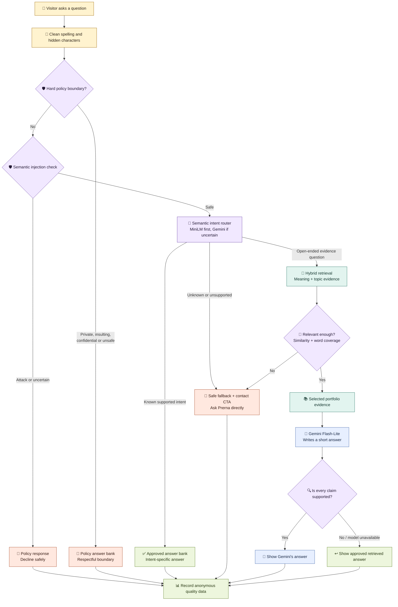

# Prerna Kapoor — Growth & Adoption Product Manager

Growth & Adoption Product Manager with 5+ years of experience building and scaling digital products across **activation, conversion, retention, customer experience, and revenue growth**.

I focus on the moments where high-intent users disengage: an abandoned booking, an unclear choice, an unread report, or a post-purchase issue. I use customer research, behavioural data, and fast experiments to turn those moments into durable product-growth loops.

## Selected Work

### Lenskart — Lenskart@Home
Owned growth initiatives across Lenskart@Home, an O2O eyewear experience spanning home trials, store ownership, and post-purchase journeys.

Selected outcomes:
- Initiatives contributed **₹6Cr+ in incremental annualised revenue**
- A personalised home-trial experience generated **₹1.8Cr annualised incremental revenue** across five cities
- A three-week, pan-India pilot improved completed home-trial bookings by **7%** versus the weekly baseline
- Territory ownership and 48-hour check-ins improved NPS for the called cohort from **41 to 60** in one month

### Bajaj Finserv Health
Built and scaled products across wellness, diagnostics, consultations, insurance, and digital health—from discovery and strategy through launch, GTM, and iteration.

Selected outcomes:
- Built a diabetes wellness business from 0→1, generating **₹28L revenue in five months**
- Smart Health Reports increased active Health Files users by **8×** and generated **₹7L+ incremental MRR**
- Doctor listing reorder improved CTR by **18%** and annual revenue by **11.6%**
- Automated insurance pre-authorisation, improving throughput by **26%** and saving **₹17L annually**

## How I Work
- Find the behavioural break in a customer journey
- Form a measurable hypothesis and test the smallest viable intervention
- Design adoption mechanics across product, operations, and lifecycle touchpoints
- Measure activation, conversion, retention, customer outcomes, and business impact
- Partner closely with design, engineering, operations, and commercial teams

## Portfolio
This repository includes detailed case studies, product experiments, and technical prototypes.

**Prerna Kapoor**  
Growth & Adoption Product Manager | Activation • Conversion • Retention • AI/Product

## Ask Prerna — portfolio chatbot

**Ask Prerna** helps visitors explore my experience, skills, projects, outcomes, and product philosophy without searching through the full portfolio.

- Recruiters get quick, evidence-based answers.
- The bot stays within information I have approved.
- Open-ended questions can use **Gemini Flash-Lite** to phrase concise, natural answers.
- Gemini runs behind a protected Vercel endpoint; its API key is never exposed in the browser.

## How one question becomes an answer

The diagram is designed to be read from top to bottom. Each colour represents a different decision path.

### Who answers what?

| Question type | Example | Answered by |
| --- | --- | --- |
| Known portfolio fact | “How much experience does she have?” | ✅ Approved answer bank |
| Work or recruiter question | “What impact did she drive at Lenskart?” | ✅ Approved answer bank |
| Open-ended portfolio question | “How does customer research shape her decisions?” | 🔎 Retrieval + 🤖 Gemini |
| Private or confidential | “What is Lenskart's profit margin?” | 📜 Policy layer |
| Inappropriate or unsafe question | — | 📜 Respectful policy response |
| Unrelated question | “Who is the US president?” | 📜 Scope boundary |
| Missing evidence | An unpublished personal or work detail | 🤷 Safe fallback |

> **Important:** Gemini does not decide the facts. It can only rewrite an approved answer using retrieved portfolio evidence. If its output cannot be verified, the bot shows the approved answer instead.

## Tech stack—in plain English

- 🖥️ **Interface:** HTML, CSS, and JavaScript create the floating chat window.
- 📚 **Knowledge base:** approved facts and boundaries live in `assets/chatbot-knowledge.js` and the curated portfolio passages in `index.html`.
- 🧭 **Intent routing:** MiniLM first classifies the meaning of unfamiliar wording into a supported intent. If confidence is low, a constrained Gemini classifier chooses from the same fixed intent list. It cannot create facts or answers.
- 🔎 **Retrieval:** open-ended evidence questions use MiniLM to find passages with similar meaning, then a strict relevance gate also requires meaningful topic-word coverage. A passage is rejected if it is merely the closest bad match.
- 🤖 **Generation:** Gemini Flash-Lite writes short responses for supported, open-ended questions through `/api/generate`.
- ⚙️ **AI runtime:** Transformers.js runs MiniLM semantic retrieval in the browser; Vercel calls Gemini server-side.
- ✅ **Validation:** checks block invented metrics, unsupported names, private claims, prompt leakage, and ungrounded sentences.
- ⚡ **Latency controls:** deterministic questions avoid AI generation; repeated clicks are blocked; semantic safety has an 8-second ceiling and Gemini has a 10-second ceiling before an approved fallback is shown.
- 🧪 **Golden evaluation dataset:** 127 fixed test cases define the expected facts, sources, intent, response type, and safety behaviour.
- 📊 **Analytics:** PostHog records anonymous quality, latency, fallback, feedback, and conversion events.
- 🚀 **Hosting:** GitHub + Vercel. The Gemini key is stored as a server-side Vercel environment variable.

## Terminology used in this project

| Term | What it means here |
| --- | --- |
| **Knowledge base** | The approved facts and portfolio passages the bot is allowed to use. |
| **Policy layer** | Rules for privacy, confidentiality, abuse, irrelevant questions, and prompt injection. |
| **Deterministic routing** | Code that sends known question types to a fixed approved response instead of asking Gemini. |
| **Semantic intent routing** | Meaning-based classification that maps different phrasings to a fixed supported category such as work style, hobbies, or bot capability. |
| **Hosted intent fallback** | A constrained Gemini classifier used only when the local semantic router is uncertain. It returns an intent label, not an answer. |
| **Hybrid retrieval** | MiniLM measures semantic similarity, while lexical coverage checks that meaningful question topics actually appear in the evidence. Both must pass. |
| **Relevance gate** | The acceptance rule that rejects the nearest passage when it does not genuinely answer the question. Rejected questions receive the safe fallback and contact CTA. |
| **Generator** | Gemini writes a concise answer using only the approved answer and retrieved evidence. |
| **Grounding checks** | Output checks verify that Gemini's claims are supported by the retrieved sources. |
| **Fail-closed fallback** | If the system is uncertain or a component fails, it returns an approved safe answer. |
| **Golden evaluation dataset** | A fixed benchmark of questions with human-defined expected facts, sources, response types, and guardrail behaviour. |
| **Regression test** | A golden case that is rerun after changes to ensure a previously working behaviour has not broken. |
| **Human-as-judge** | A person reviews the actual answer for correctness, relevance, tone, and helpfulness. |
| **Telemetry** | Anonymous product data used to monitor latency, fallbacks, errors, helpfulness, and conversions. |

<strong>🛡️ Safety controls</strong>

- Detects direct and disguised prompt-injection attempts.
- Handles common spelling errors and selected Unicode or zero-width tricks.
- Limits questions to 500 characters and generated answers to 300 characters.
- Falls back safely when retrieval or the Gemini endpoint is unavailable, rate-limited, or slow.
- Keeps the Gemini API key on the server and accepts only allowlisted approved answers and sources.
- Applies a best-effort browser limit of 10 questions per minute.
- Keeps private, NSFW, confidential, and unsupported topics out of answers.

These controls reduce risk but are not foolproof. The client-side knowledge base should be treated as publicly visible.

## Golden evaluation dataset and eval console

The **golden evaluation dataset** lives in [`assets/eval-dataset.js`](assets/eval-dataset.js). Its 127 cases are the benchmark used to test the **whole RAG system**: intent routing, retrieval, policy responses, Gemini output, fallbacks, safety, and response time. Because generated wording can vary, it defines required facts and behaviour rather than one exact sentence.

Each golden case contains:

- The test question and category
- The expected response type
- The expected semantic intent when the case tests meaning-based routing
- The facts the answer must contain
- The source it should retrieve
- The guardrail behaviour expected for safety cases

The [**eval console**](eval.html) runs these cases through the real chatbot and brings the expected and actual results together for review. It can filter results by answer source, including policy, LLM, fallback, guardrail, and error paths. Each result separates total request latency from the time spent in model generation, so slow retrieval or safety checks are not confused with a slow model.

For an open-ended case, **Compare models** runs the same question, retrieval, approved evidence, validation rules, and length limit through Gemini Flash-Lite and browser-hosted Qwen 2.5. The side-by-side output isolates generator quality from retrieval or routing quality and shows total latency, model-generation latency, answer source, and fallback status. If a policy answer bypasses both models, the console says so instead of presenting identical answers as a meaningful model comparison. Qwen is evaluation-only; it is not used by the visitor-facing bot.

### What the golden dataset covers

- ✅ Profile facts, skills, experience, work and measurable outcomes
- ✍️ Paraphrases, misspellings and fuzzy matching
- 🧭 Vague wording that should converge on the same semantic intent
- 🔒 Private, confidential, insulting and unrelated questions
- 🧨 Direct, disguised, multilingual and Unicode prompt injections
- 🚫 Invented metrics, fake employers, prompt leakage and unsupported claims
- 📴 Unavailable generation endpoint, timeouts and retrieval failures
- 🎯 False-positive checks so valid recruiter questions are not blocked

### What the reviewer can do

- Run all cases or rerun only those marked incorrect.
- Compare Gemini Flash-Lite and Qwen 2.5 side by side on an individual case.
- Compare the answer with expected facts, sources and guardrail behaviour.
- Mark it **Correct** or **Incorrect** and give a 1–5 helpfulness score.
- Speak feedback through voice dictation or type a reason.
- Export or import the review as JSON for the next iteration.

### How live feedback improves the bot

Every chatbot answer asks **“Was this helpful?”**

- 👍 **Helpful:** PostHog records a positive helpfulness signal.
- 👎 **Not helpful:** the visitor can select **Missing information**, **Incorrect information**, **Irrelevant answer**, **Too verbose**, or **Poor tone**.
- 🔗 The rating and reason are joined to the original question and answer through a request ID.
- 🔍 I review patterns to identify whether the problem is the knowledge base, retrieval, routing, generation, or tone.
- 🛠️ I update the relevant layer, rerun the golden dataset, and check that the fix does not break another answer.

This creates a continuous product loop:

`💬 Answer → 👍/👎 Feedback → 📊 PostHog analysis → 🛠️ Improvement → 🧪 Regression test → 🚀 Release`

## PostHog: measuring the portfolio as a product

PostHog is used for more than chatbot performance. It shows whether visitors discover relevant work, engage with the portfolio, and take a meaningful next step.

### Portfolio funnel

| Funnel stage | Product question | Signals monitored |
| --- | --- | --- |
| **Reach** | Are people finding the portfolio? | Page views, anonymous visitors, traffic source and campaign |
| **Explore** | Which work attracts interest? | Case-study opens and chatbot opens |
| **Engage** | Are visitors meaningfully interacting? | Questions asked, question themes, helpfulness and feedback reasons |
| **Consider** | Do visitors want more evidence? | Resume clicks and repeated case-study exploration |
| **Convert** | Do visitors want to speak with me? | Contact-section, email, phone and WhatsApp clicks |

### AI product health

| Quality | Performance and cost | Safety |
| --- | --- | --- |
| Correctness and helpfulness | P50/P95 latency | Injection decisions |
| Fallback and error rate | Cache hit/miss | Rate-limit events |
| Retrieved sources | Input/output tokens | Unsupported-output rejections |
| Feedback reasons | Estimated cost | Fail-closed responses |

The golden dataset is a **testing benchmark**, not the chatbot's knowledge base and not training data. This is **human-as-judge evaluation**, not automatic model training. Feedback is used to improve the answer bank, retrieval, guardrails, and regression suite; Gemini is not silently retrained.

See [TELEMETRY.md](TELEMETRY.md) and the [preproduction security audit](evaluations/PREPROD-SECURITY-AUDIT-2026-10-10.md).

## Product changelog

| Stage | What we had | Gap or insight | What changed and why |
| --- | --- | --- | --- |
| **1. First chatbot** | A separate portfolio section with retrieval-based answers | Visitors had to scroll to find it; many did not know what to ask | Replaced it with a visible floating bot and starter questions |
| **2. Curated answer bank** | Broad portfolio matching | Insults, private questions, confidentiality and unrelated queries could return irrelevant work answers | Added deterministic routing and an approved policy layer for safe, graceful responses |
| **3. Better portfolio coverage** | Mostly project and company information | Recruiter questions about experience, skills, personality, location and hobbies were inconsistent | Expanded the approved knowledge base with verified professional and personal-profile facts |
| **4. Semantic retrieval** | Keyword and static-text matching | Misspellings and paraphrased questions were easy to misroute | Added fuzzy correction and MiniLM semantic retrieval to match meaning rather than exact words |
| **5. Open-source generation** | Retrieved, prewritten responses only | The experience demonstrated retrieval but not generative AI | Added browser-hosted Qwen 2.5 for concise synthesis from retrieved evidence, with ₹0 model API cost |
| **6. Evaluation system** | Manual spot checks | Improvements could fix one answer while breaking another | Built the golden dataset and eval console with human-as-judge review, incorrect-only reruns, voice feedback and JSON export |
| **7. Production hardening** | Basic keyword guardrails | Obfuscated injections, invented claims and component failures needed stronger handling | Added semantic injection detection, Unicode checks, grounding validation, fail-closed fallbacks and throttling |
| **8. Product analytics** | Technical latency and answer logs | Bot quality alone did not show whether the portfolio created recruiter interest | Added PostHog portfolio funnels, structured feedback and resume, case-study and contact conversions |
| **9. Latency fast path** | Every question waited for the semantic security model; opening chat preloaded the embedding index | Even fixed answers could take seconds, and the Skills nudge appeared unresponsive | Routed approved intents before model loading, made MiniLM lazy, blocked duplicate requests, added visible progress, and capped the Qwen wait at 12 seconds |
| **10. Hosted generation** | Qwen generated answers inside each visitor's browser | The first generative answer depended on a large model download, WebGPU support, and device performance | Replaced Qwen generation with Gemini Flash-Lite behind a protected Vercel endpoint; MiniLM retrieval, approved facts, output validation, and fail-closed fallbacks remain unchanged |
| **11. Evidence-gated retrieval and model comparison** | Semantic retrieval chose the nearest passage, and generator comparisons were subjective | The nearest passage could still be irrelevant, while total latency hid model speed | Added meaningful-topic coverage, source filtering, generation latency, and Qwen-versus-Gemini comparison in the eval console |
| **12. Semantic intent routing** | Supported questions depended heavily on exact route patterns | Short, vague, or unfamiliar wording could miss the correct answer even when the knowledge existed | Added a MiniLM intent router, constrained Gemini fallback classifier, intent confidence telemetry, and intent-level eval cases |

## Cost and trade-offs

- **Model cost:** expected to remain ₹0 while the project stays within Gemini's free-tier quota; telemetry also records a paid-rate estimate for visibility.
- **Fast path:** approved and policy answers return without calling Gemini.
- **Trade-off:** open-ended generation now depends on a network service and its quota instead of the visitor's device.
- **Intent trade-off:** ambiguous wording may use one small hosted classification call before answering; high-confidence local intents and fixed policy routes avoid it.
- **Compatibility:** generation no longer requires WebGPU; if Gemini fails or times out, the bot returns the approved answer.
- **Privacy:** only public portfolio questions and allowlisted evidence should reach Gemini. Email addresses and phone numbers are redacted server-side.
- **Free-tier caveat:** Google's free tier is quota-based, not guaranteed as a one-month trial, and its data-use terms differ from the paid tier. Recheck current terms before production use.

The preproduction build is connected to the `codex/portfolio-rag-preprod` branch and is intentionally separate from production.
