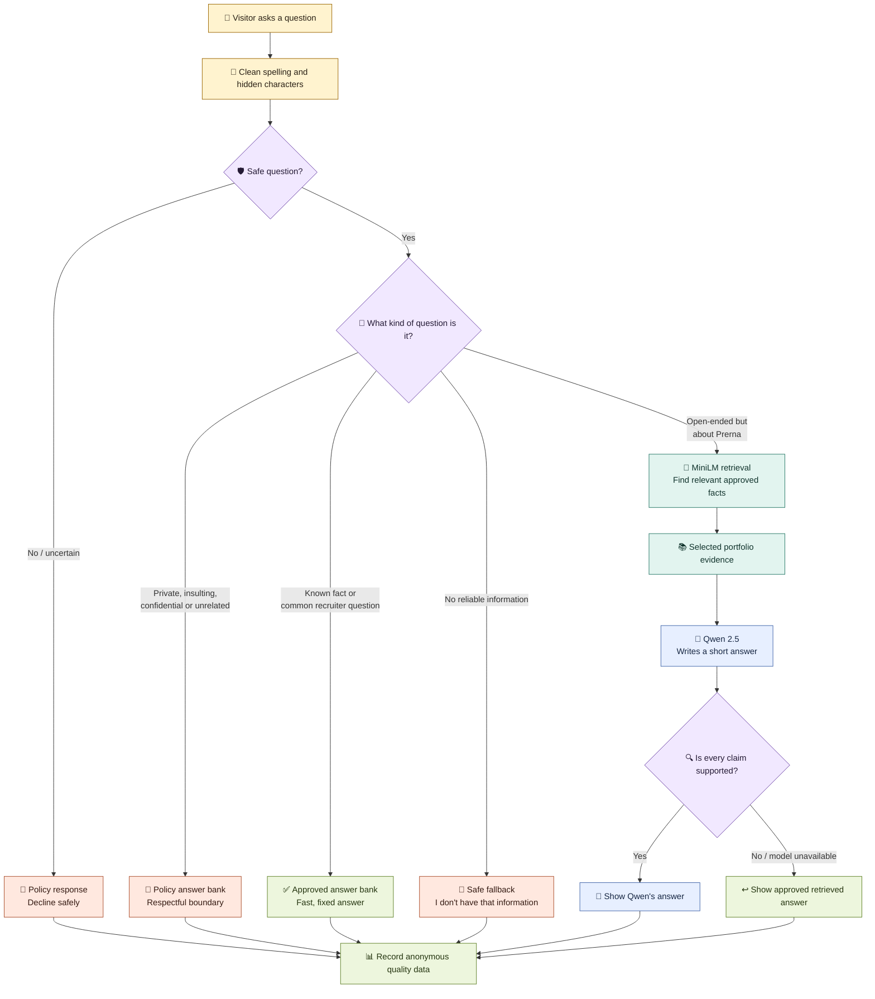
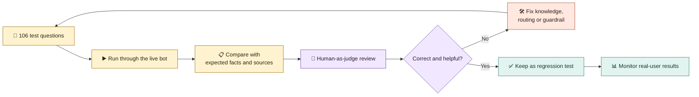

# Prerna Kapoor — Growth & Adoption Product Manager

Growth & Adoption Product Manager with 5+ years of experience building and scaling digital products across **activation, conversion, retention, customer experience, and revenue growth**.

I focus on the moments where high-intent users disengage: an abandoned booking, an unclear choice, an unread report, or a post-purchase issue. I use customer research, behavioural data, and fast experiments to turn those moments into durable product-growth loops.

## Selected Work

### Lenskart — Lenskart@Home
Owned growth initiatives across Lenskart@Home, an O2O eyewear experience spanning home trials, store ownership, and post-purchase journeys.

Selected outcomes:
- Initiatives contributed **₹6Cr+ in incremental annualised revenue**
- A personalised home-trial experience generated **₹1.8Cr annualised incremental revenue** across five cities
- A three-week, pan-India pilot improved completed home-trial bookings by **7%** versus the weekly baseline
- Territory ownership and 48-hour check-ins improved NPS for the called cohort from **41 to 60** in one month

### Bajaj Finserv Health
Built and scaled products across wellness, diagnostics, consultations, insurance, and digital health—from discovery and strategy through launch, GTM, and iteration.

Selected outcomes:
- Built a diabetes wellness business from 0→1, generating **₹28L revenue in five months**
- Smart Health Reports increased active Health Files users by **8×** and generated **₹7L+ incremental MRR**
- Doctor listing reorder improved CTR by **18%** and annual revenue by **11.6%**
- Automated insurance pre-authorisation, improving throughput by **26%** and saving **₹17L annually**

## How I Work
- Find the behavioural break in a customer journey
- Form a measurable hypothesis and test the smallest viable intervention
- Design adoption mechanics across product, operations, and lifecycle touchpoints
- Measure activation, conversion, retention, customer outcomes, and business impact
- Partner closely with design, engineering, operations, and commercial teams

## Portfolio
This repository includes detailed case studies, product experiments, and technical prototypes.

**Prerna Kapoor**  
Growth & Adoption Product Manager | Activation • Conversion • Retention • AI/Product

## Ask Prerna — portfolio chatbot

**Ask Prerna** helps visitors explore my experience, skills, projects, outcomes, and product philosophy without searching through the full portfolio.

- Recruiters get quick, evidence-based answers.
- The bot stays within information I have approved.
- Open-ended questions can use an open-source AI model, **Qwen 2.5**.
- It runs in the visitor's browser, so there is no paid AI API call per question.

## How one question becomes an answer

The diagram is designed to be read from top to bottom. Each colour represents a different decision path.

### Who answers what?

| Question type | Example | Answered by |
| --- | --- | --- |
| Known portfolio fact | “How much experience does she have?” | ✅ Approved answer bank |
| Work or recruiter question | “What impact did she drive at Lenskart?” | ✅ Approved answer bank |
| Open-ended portfolio question | “How does customer research shape her decisions?” | 🔎 Retrieval + 🤖 Qwen |
| Private or confidential | “What is Lenskart's profit margin?” | 📜 Policy layer |
| Insult or unsafe request | “Why is she…?” | 📜 Respectful policy response |
| Unrelated question | “Who is the US president?” | 📜 Scope boundary |
| Missing evidence | An unpublished personal or work detail | 🤷 Safe fallback |

> **Important:** Qwen does not decide the facts. It can only rewrite information retrieved from the approved knowledge base. If its answer cannot be verified, the bot uses the approved answer instead.

## Tech stack—in plain English

- 🖥️ **Interface:** HTML, CSS, and JavaScript create the floating chat window.
- 📚 **Knowledge base:** approved facts and boundaries live in `assets/chatbot-knowledge.js` and the curated portfolio passages in `index.html`.
- 🔎 **Retrieval:** MiniLM finds the approved passages closest in meaning to the question.
- 🤖 **Generation:** Qwen2.5-0.5B-Instruct writes short responses for supported, open-ended questions.
- ⚙️ **AI runtime:** Transformers.js + WebGPU run MiniLM and Qwen inside the browser.
- ✅ **Validation:** checks block invented metrics, unsupported names, private claims, prompt leakage, and ungrounded sentences.
- 📊 **Analytics:** PostHog records anonymous quality, latency, fallback, feedback, and conversion events.
- 🚀 **Hosting:** GitHub + Vercel. No database or paid model API is required.

<strong>🛡️ Safety controls</strong>

- Detects direct and disguised prompt-injection attempts.
- Handles common spelling errors and selected Unicode or zero-width tricks.
- Limits questions to 500 characters and generated answers to 300 characters.
- Falls back safely when retrieval, WebGPU, or Qwen is unavailable.
- Applies a best-effort browser limit of 10 questions per minute.
- Keeps private, NSFW, confidential, and unsupported topics out of answers.

These controls reduce risk but are not foolproof. The client-side knowledge base should be treated as publicly visible.

## How I evaluate the AI

The evaluation console at `eval.html` is the quality-control system for the chatbot. It tests the **whole RAG experience**—routing, retrieval, policy responses, Qwen output, fallbacks, safety, and response time.

### What the 106 cases cover

- ✅ Profile facts, skills, experience, work and measurable outcomes
- ✍️ Paraphrases, misspellings and fuzzy matching
- 🔒 Private, confidential, insulting and unrelated questions
- 🧨 Direct, disguised, multilingual and Unicode prompt injections
- 🚫 Invented metrics, fake employers, prompt leakage and unsupported claims
- 📴 Missing WebGPU, failed model loading and retrieval failures
- 🎯 False-positive checks so valid recruiter questions are not blocked

### What the reviewer can do

- Run all cases or rerun only those marked incorrect.
- Compare the answer with expected facts, sources and guardrail behaviour.
- Mark it **Correct** or **Incorrect** and give a 1–5 helpfulness score.
- Speak feedback through voice dictation or type a reason.
- Export or import the review as JSON for the next iteration.

### Product metrics I monitor

| Quality | Performance | Business value |
| --- | --- | --- |
| Correctness and helpfulness | P50/P95 latency | Resume clicks |
| Fallback and error rate | Cache hit/miss | Case-study clicks |
| Retrieved sources | Input/output tokens | Contact clicks |
| Safety decisions | Estimated cost | Questions visitors ask |

This is **human-as-judge evaluation**, not automatic model training. Feedback is used to improve the answer bank, retrieval, guardrails, and regression tests; Qwen is not silently retrained.

See [TELEMETRY.md](TELEMETRY.md) and the [preproduction security audit](evaluations/PREPROD-SECURITY-AUDIT-2026-10-10.md).

## Cost and trade-offs

- **Model cost per question:** ₹0—the open-source models run locally in the browser.
- **Fast path:** approved answers return without waiting for Qwen.
- **Trade-off:** the first generative answer may be slower because the browser must download and initialise Qwen.
- **Compatibility:** if WebGPU is unavailable, the bot returns the approved retrieved answer.

## Where to make changes

| To change… | Edit… |
| --- | --- |
| Approved facts and policy responses | `assets/chatbot-knowledge.js` |
| Retrieval passages and routing | `index.html` |
| Qwen generation settings | `assets/qwen-worker.js` |
| Evaluation questions | `assets/eval-dataset.js` |
| Evaluation interface | `eval.html` |
| Analytics definitions | `TELEMETRY.md` |

The preproduction build is connected to the `codex/portfolio-rag-preprod` branch and is intentionally separate from production.
